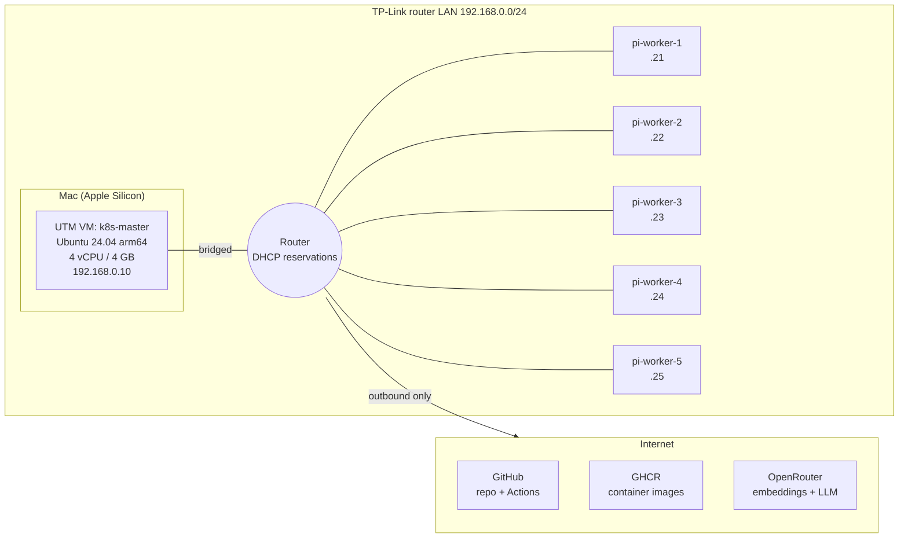
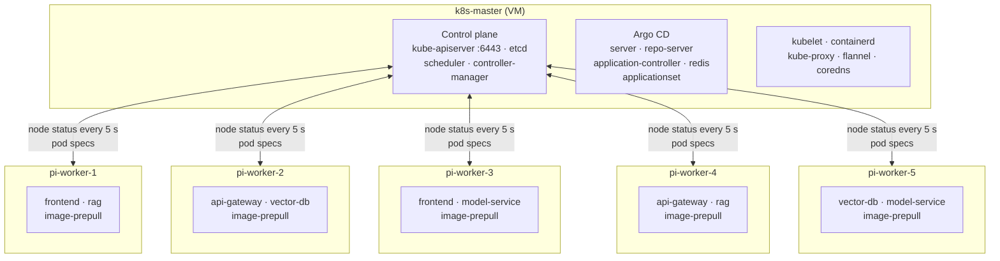
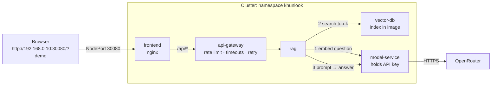
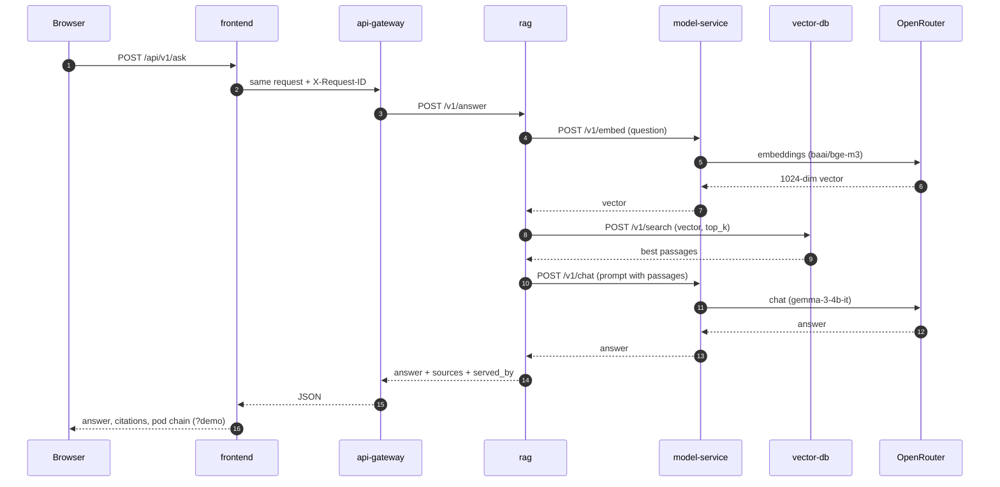
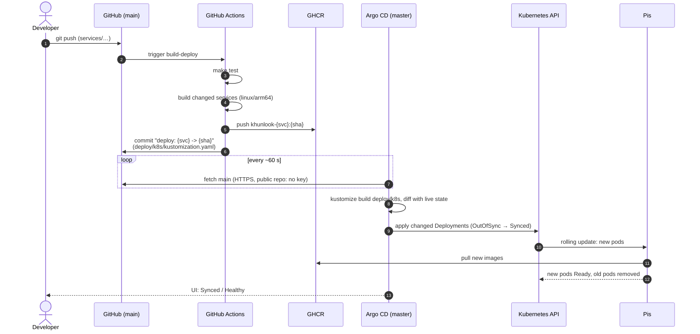
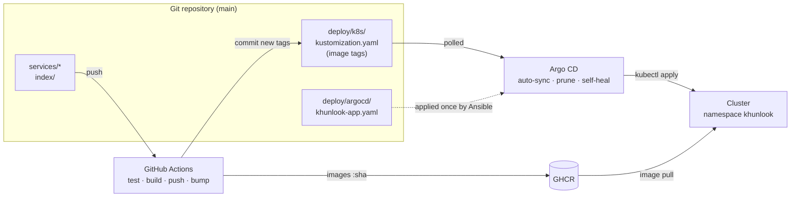
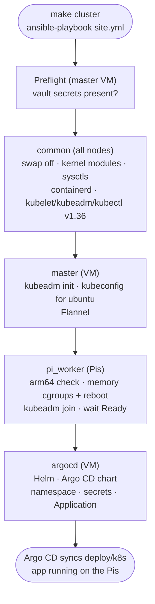
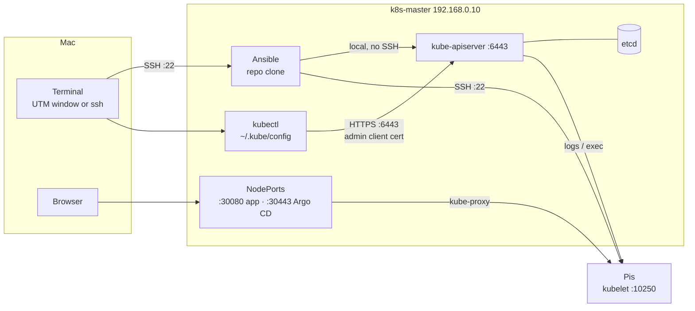
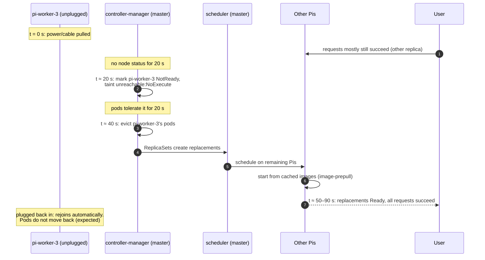

# Infrastructure diagrams

How KhunLook's infrastructure fits together: the machines, what runs where, how a request travels,
how code gets deployed, and what happens when a Pi is unplugged. Every IP, Service and port in detail: [network.md](network.md). Setup steps are in
[infra/README.md](../infra/README.md).

IPs below follow the plan in [`infra/ansible/inventory.ini`](../infra/ansible/inventory.ini)
(master `192.168.0.10`, Pis `.21`–`.25`); substitute your own.

---

## 1. Physical network

One Mac hosts the master as a bridged Ubuntu VM in UTM, so the VM sits on the router's LAN next to
the five Raspberry Pis. Only outbound internet is needed: nothing on the internet connects into the LAN.

| Machine | Hardware | Role |
|---------|----------|------|
| `k8s-master` | UTM VM on the Mac, arm64, 4 vCPU, 4 GB, 30 GB | Kubernetes control plane + Argo CD. Never runs app pods |
| `pi-worker-1…5` | Raspberry Pi 3 B+, arm64, 1 GB | Runs all application pods |

---

## 2. What runs on each node

The master keeps kubeadm's `control-plane:NoSchedule` taint, so only system pods and Argo CD
(which tolerates the taint and is pinned there) run on it. Every app service has 2 replicas,
spread over different Pis by pod anti-affinity. Placement below is one example: the scheduler
decides, and it changes after a Pi fails.

Every Pi also runs `kubelet`, `containerd`, `kube-proxy` and `flannel` (omitted above).
`image-prepull` is a DaemonSet that keeps all five app images cached on every Pi, so pods
recreated after a failure start without downloading anything.

| Namespace | Contents |
|-----------|----------|
| `kube-system` | control plane, kube-proxy, coredns |
| `kube-flannel` | Flannel pod network (`10.244.0.0/16`, VXLAN between nodes) |
| `argocd` | Argo CD (Helm chart 10.17.2), repo credentials secret |
| `khunlook` | the 5 app Deployments + Services, `image-prepull`, `openrouter` secret |

---

## 3. A chat request

The browser only ever talks to the master's IP. kube-proxy forwards NodePort 30080 to a frontend
pod on whichever Pi is alive; from there each hop goes through a ClusterIP Service, which picks a
ready replica, usually on a different Pi. Each answer passes through at least 4 containers.

---

## 4. Deploying a change (GitOps)

Git is the source of truth. CI turns code into images and records their tags in Git; Argo CD,
running inside the cluster, pulls Git and makes the cluster match. Nothing pushes into the LAN.

What Argo CD does **not** manage: its own installation (Helm, via Ansible) and the `openrouter`
API key secret, which Ansible creates from the git-ignored `vault.yml` so it never appears in Git. Argo CD needs no
secret to read the repository: it is public and read over HTTPS.

---

## 5. Building the cluster (Ansible)

One playbook, run on the master VM (local connection to itself, SSH to the Pis), takes fresh machines to a cluster that deploys itself.

---

## 6. How you reach the cluster

| Port | On | Used by |
|------|----|---------|
| 22 | Pis | Ansible on the master (SSH) |
| 22 | master | your terminal from the Mac (optional; the UTM window works too) |
| 6443 | master | `kubectl`, kubelets, Argo CD → API server |
| 10250 | all nodes | API server → kubelet (logs, exec) |
| 8472/udp | all nodes | Flannel VXLAN pod traffic between nodes |
| 30080 | every node (use the master's IP) | Chatbot |
| 30443 | every node (use the master's IP) | Argo CD UI |

---

## 7. When a Pi is unplugged

Kubernetes, not Argo CD, does the recovery; Argo CD only reports health. Timings come from
`node_monitor_grace_period: 20s` (Ansible) and `tolerationSeconds: 20` (manifests).

