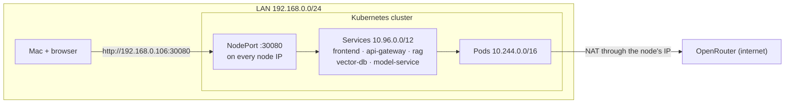
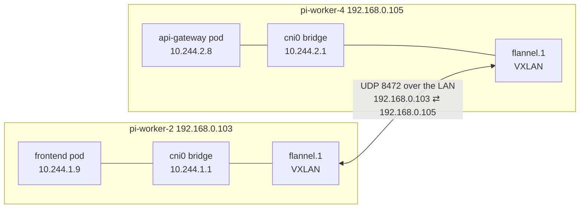
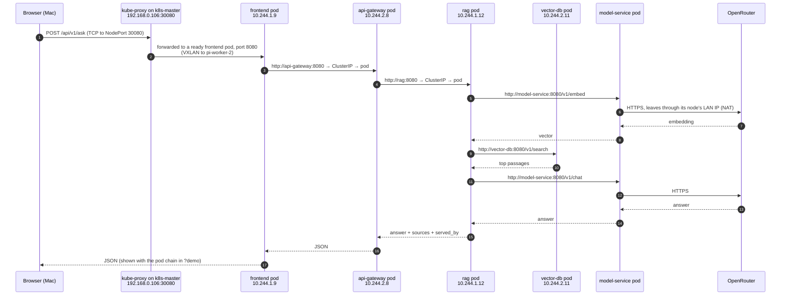

# Network setup

Every address in the KhunLook cluster: the machines, the pods, the Services, the DNS names, the ports,
and how one chat request travels from a browser through five pods to OpenRouter and back.

See also: [infrastructure.md](infrastructure.md) (machines, GitOps, failover) and
[infra/README.md](../infra/README.md) (setup).

> **Pod IPs change.** Every time a pod is recreated (new deploy, Pi unplugged), it gets a new IP. So do not
> write pod IPs into configuration. Services and DNS names are what stay fixed. The examples marked
> *snapshot* below are what the cluster looked like at one moment. [Section 9](#9-see-the-current-addresses)
> shows how to read the current values.

---

## 1. The four address ranges

| Range | What gets these addresses | Who assigns them | Reachable from |
|-------|---------------------------|------------------|----------------|
| `192.168.0.0/24` | **Machines**: router, Mac, master VM, Pis | TP-Link router (DHCP reservations) | the whole LAN |
| `10.244.0.0/16` | **Pods**: one IP per pod | Kubernetes + Flannel, a `/24` block per node | inside the cluster only |
| `10.96.0.0/12` | **Services**: one stable virtual IP (ClusterIP) per Service | kube-apiserver, when the Service is created | inside the cluster only |
| `*.svc.cluster.local` | **DNS names** for Services, e.g. `rag.khunlook.svc.cluster.local` | CoreDNS (`10.96.0.10`) | inside the cluster only |

Only one way leads from the LAN into the cluster: **NodePorts** (`30080` app, `30443` Argo CD) on the
nodes' LAN IPs.



---

## 2. Machines (LAN)

| Node | LAN IP | Pod block (`podCIDR`) | Bridge `cni0` | OS | Runs |
|------|--------|-----------------------|---------------|----|------|
| `k8s-master` | `192.168.0.106` | `10.244.0.0/24` | `10.244.0.1` | Ubuntu 24.04 (UTM VM) | control plane, CoreDNS, Argo CD |
| `pi-worker-2` | `192.168.0.103` | `10.244.1.0/24` * | `10.244.1.1` | Raspberry Pi OS (Debian 13) | app pods |
| `pi-worker-4` | `192.168.0.105` | `10.244.2.0/24` * | `10.244.2.1` | Raspberry Pi OS (Debian 13) | app pods |
| `pi-worker-1`, `-3`, `-5` | from `inventory.ini` | next free `/24` when they join | `.1` of their block | Raspberry Pi OS | app pods |
| router | `192.168.0.1` | | | TP-Link | DHCP, default gateway, internet |

\* Pod blocks are handed out in the order the nodes join, so they can differ after a rebuild.
The master always gets `10.244.0.0/24` because it is created first.

The LAN IPs come from DHCP reservations on the router. **The master's IP must never change**: it is
written into the cluster certificates (see [infra/README.md](../infra/README.md#troubleshooting)).

---

## 3. Pod network (Flannel)

Each node gives its pods IPs from its own `/24` block. Pods on the same node talk over the node's
`cni0` bridge. Pods on **different** nodes talk through Flannel: it wraps the pod-to-pod packet in a
UDP packet (VXLAN, port **8472**) and sends it between the nodes' LAN IPs.



*(snapshot pod IPs)*

What a cross-node packet looks like:

```
outer:  192.168.0.103 → 192.168.0.105   UDP 8472 (VXLAN)      ← what the router sees
inner:  10.244.1.9    → 10.244.2.8      TCP 8080              ← what the pods see
```

| Setting | Value | Where it is set |
|---------|-------|-----------------|
| Pod network | `10.244.0.0/16` | `podSubnet` in [kubeadm-config.yaml.j2](../infra/ansible/roles/master/templates/kubeadm-config.yaml.j2), Flannel's default |
| Block per node | `/24` (254 pods per node) | Kubernetes default |
| Backend | VXLAN, UDP 8472 | Flannel default |
| MTU inside pods | 1450 (LAN 1500 minus 50 bytes of VXLAN header) | Flannel, automatic |
| CNI plugins | `/opt/cni/bin` | containerd config (Debian's default `/usr/lib/cni` is fixed by Ansible) |

---

## 4. Services: the stable addresses

A pod never calls another pod's IP. It calls a **Service name**, for example `http://rag:8080`.
CoreDNS turns the name into the Service's ClusterIP, and **kube-proxy** on the node (iptables
rules) sends the connection to one of the Service's *ready* pods, on any node.

### App Services (namespace `khunlook`)

| Service | Type | ClusterIP | Port → pod port | NodePort | DNS name | Pods it selects | Called by |
|---------|------|-----------|-----------------|----------|----------|-----------------|-----------|
| `frontend` | NodePort | from `10.96.0.0/12` | `8080 → 8080` | **`30080`** | `frontend.khunlook.svc.cluster.local` | `app=frontend` | browsers, via any node's IP |
| `api-gateway` | ClusterIP | from `10.96.0.0/12` | `8080 → 8080` | | `api-gateway.khunlook.svc.cluster.local` | `app=api-gateway` | frontend (nginx `/api/*`) |
| `rag` | ClusterIP | from `10.96.0.0/12` | `8080 → 8080` | | `rag.khunlook.svc.cluster.local` | `app=rag` | api-gateway (`RAG_URL`) |
| `vector-db` | ClusterIP | from `10.96.0.0/12` | `8080 → 8080` | | `vector-db.khunlook.svc.cluster.local` | `app=vector-db` | rag (`VECTOR_DB_URL`) |
| `model-service` | ClusterIP | from `10.96.0.0/12` | `8080 → 8080` | | `model-service.khunlook.svc.cluster.local` | `app=model-service` | rag (`MODEL_SERVICE_URL`) |

A ClusterIP is picked when the Service is first created and stays the same until the Service is
deleted. Argo CD only updates the Services, so in practice they don't change. Look them up with
`kubectl -n khunlook get svc`.

Every app container listens on **8080**, and every Service also uses 8080. That makes the URLs
predictable: `http://<service>:8080`.

### System Services

| Service | Namespace | ClusterIP | Ports | NodePort | Purpose |
|---------|-----------|-----------|-------|----------|---------|
| `kubernetes` | `default` | `10.96.0.1` | 443 | | the API server, for pods (Flannel, Argo CD) |
| `kube-dns` | `kube-system` | `10.96.0.10` | 53/udp, 53/tcp | | CoreDNS: every pod's DNS server |
| `argocd-server` | `argocd` | `10.110.122.199` * | 80, 443 | **`30081`**, **`30443`** | Argo CD web UI + API |
| `argocd-repo-server` | `argocd` | `10.97.189.112` * | 8081 | | renders `deploy/k8s` from Git |
| `argocd-redis` | `argocd` | `10.102.122.174` * | 6379 | | Argo CD cache |
| `argocd-applicationset-controller` | `argocd` | `10.106.124.93` * | 7000 | | (unused here) |
| `argocd-application-controller` | `argocd` | none (headless) | | | compares Git with the cluster |

\* *snapshot*; these get new values when Argo CD is reinstalled. `10.96.0.1` and `10.96.0.10` are fixed by kubeadm.

### How a name becomes an address

Every pod's `/etc/resolv.conf` points at CoreDNS and has search domains for its namespace:

```
nameserver 10.96.0.10
search khunlook.svc.cluster.local svc.cluster.local cluster.local
```

So inside a `khunlook` pod, the short name `rag` becomes `rag.khunlook.svc.cluster.local`, which
resolves to the `rag` Service's ClusterIP. From a pod in another namespace, use `rag.khunlook`.

---

## 5. Deployments and their pods

All in namespace `khunlook`. Replicas are set in each manifest under [deploy/k8s](../deploy/k8s);
currently **1** each.

| Deployment | Image | Replicas | Container port | Calls (env) | Health checks |
|------------|-------|----------|----------------|-------------|---------------|
| `frontend` | `khunlook-frontend` (nginx) | 1 | 8080 | `api-gateway:8080` (nginx upstream) | `/healthz` |
| `api-gateway` | `khunlook-api-gateway` | 1 | 8080 | `RAG_URL=http://rag:8080` | live `/healthz`, ready `/readyz` |
| `rag` | `khunlook-rag` | 1 | 8080 | `VECTOR_DB_URL=http://vector-db:8080`, `MODEL_SERVICE_URL=http://model-service:8080` | live `/healthz`, ready `/readyz` |
| `vector-db` | `khunlook-vector-db` | 1 | 8080 | nothing (index is inside the image) | live `/healthz`, ready `/readyz` |
| `model-service` | `khunlook-model-service` | 1 | 8080 | `https://openrouter.ai` (internet) | live `/healthz`, ready `/readyz` |
| `image-prepull` (DaemonSet) | all five + `pause` | 1 per Pi | none | nothing | |

**Pod IPs.** Each pod gets the next free IP in the block of the node it lands on: a pod on
pi-worker-2 gets `10.244.1.x`, on pi-worker-4 `10.244.2.x`. The **readiness check** decides whether
a pod receives traffic: until `/readyz` answers OK, the pod is left out of its Service.

Example *(snapshot, from when every service had 2 replicas)*:

| Pod | IP | Node |
|-----|----|------|
| `frontend-…-qfppm` | `10.244.1.9` | pi-worker-2 |
| `frontend-…-w5qt4` | `10.244.2.12` | pi-worker-4 |
| `api-gateway-…-t6tbn` | `10.244.1.13` | pi-worker-2 |
| `api-gateway-…-ds92f` | `10.244.2.8` | pi-worker-4 |
| `rag-…-kj9j5` | `10.244.1.12` | pi-worker-2 |
| `rag-…-rx5tz` | `10.244.2.9` | pi-worker-4 |
| `vector-db-…-blmqr` | `10.244.1.8` | pi-worker-2 |
| `vector-db-…-8xvbh` | `10.244.2.11` | pi-worker-4 |
| `image-prepull-…` | `10.244.1.11` / `10.244.2.10` | one per Pi |

`kube-proxy` and `kube-flannel` pods are different: they use the **node's own IP** (`hostNetwork`),
because they set up the network for everyone else.

---

## 6. One chat request, hop by hop

The browser asks a question at `http://192.168.0.106:30080/?demo`. *(Addresses: snapshot pods above.)*



What each hop really does:

| Step | Destination as written | Becomes | Done by |
|------|------------------------|---------|---------|
| 1–2 | `192.168.0.106:30080` | a ready frontend pod `:8080`, possibly on another node | kube-proxy (iptables NAT on the node that received it) |
| 3 | `api-gateway:8080` | `api-gateway` ClusterIP `:8080` → a ready gateway pod | CoreDNS, then kube-proxy on the frontend's node |
| 4 | `rag:8080` | `rag` ClusterIP → a ready rag pod | CoreDNS + kube-proxy |
| 5, 9, 11 | `model-service:8080`, `vector-db:8080` | ClusterIP → a ready pod | CoreDNS + kube-proxy |
| 6, 12 | `openrouter.ai:443` | public IP, source rewritten to the node's LAN IP | Flannel's masquerade rule, then the router's NAT |

**NodePort works on every node.** `192.168.0.103:30080` and `192.168.0.105:30080` work too. The master
is the one to use because it never runs app pods and is never unplugged during the demo.

---

## 7. Traffic leaving the cluster

| From | To | Why | How |
|------|----|-----|-----|
| model-service pods | `openrouter.ai:443` | embeddings + LLM | NAT through the Pi's IP, then the router |
| containerd on every Pi | `ghcr.io:443` | pull app images | the Pi's own IP |
| Argo CD repo-server (master) | `github.com:443` (HTTPS, no key) | read `deploy/k8s` on `main` every ~60 s | NAT through the master's IP |
| apt on every node | `pkgs.k8s.io`, Debian/Ubuntu mirrors | packages (Ansible only) | node IP |

Nothing on the internet connects *into* the LAN; there are no port forwards on the router.

---

## 8. Ports reference

| Port | Protocol | On | Used for |
|------|----------|----|----------|
| 22 | TCP | all nodes | SSH (Ansible) |
| 6443 | TCP | master | Kubernetes API (`kubectl`, kubelets, Flannel, Argo CD) |
| 2379–2380 | TCP | master (local only) | etcd |
| 10250 | TCP | all nodes | kubelet API (`kubectl logs` / `exec`) |
| 8472 | UDP | all nodes | Flannel VXLAN: pod traffic between nodes |
| 53 | UDP/TCP | CoreDNS pods (`10.96.0.10`) | DNS inside the cluster |
| 8080 | TCP | every app pod and Service | the app's HTTP |
| 30080 | TCP | every node's LAN IP | chatbot (frontend NodePort) |
| 30443 / 30081 | TCP | every node's LAN IP | Argo CD UI (HTTPS / HTTP) |

---

## 9. See the current addresses

On the master VM:

```bash
kubectl get nodes -o custom-columns='NODE:.metadata.name,IP:.status.addresses[0].address,PODS:.spec.podCIDR'
kubectl -n khunlook get svc -o wide          # ClusterIPs, ports, NodePort
kubectl -n khunlook get pods -o wide         # pod IPs and their node
kubectl -n khunlook get endpointslices       # which pod IPs each Service sends to right now
kubectl get svc -A                           # every Service, including system and Argo CD
```

Test names and ports from inside the cluster with a throwaway pod:

```bash
kubectl -n khunlook run nettest --rm -it --restart=Never --image=busybox:1.36 -- sh
  nslookup rag                       # → rag.khunlook.svc.cluster.local + its ClusterIP
  wget -qO- http://vector-db:8080/healthz
  wget -qO- http://api-gateway:8080/healthz
```
